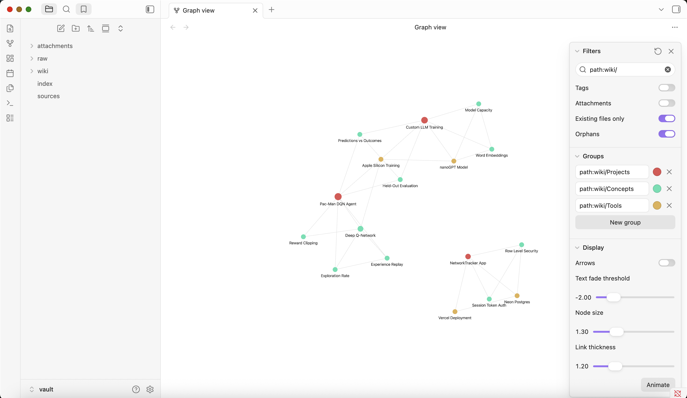

# Personal Wiki: local Gemma + RAG, from the command line

A personal wiki about my AgenticAI course projects, built and queried by **my own Python CLI and harness** around a **local Gemma 4 E2B** model. It works fully offline. Three modes behave differently by design: **chat** (a personal assistant with memory of the conversation), **ask** (standalone, cited factual answers or "insufficient evidence"), and **search** (the original passages, with no model involved). The wiki is an ordinary Obsidian vault.

| | |
|---|---|
| CLI + harness code | [`wiki`](wiki) (launcher) → [`wikicli/`](wikicli/) |
| The Obsidian vault | [`vault/`](vault/) → start at [`vault/index.md`](vault/index.md) |
| Original sources (unchanged) | [`vault/raw/`](vault/raw/) · catalog [`vault/sources.md`](vault/sources.md) |
| Instructions the harness loads | [`instructions/`](instructions/): research rules, persona, ingest rules |
| Four ask-mode evidence cards | **[`evidence/ask/20260928-152543-offline/`](evidence/ask/20260928-152543-offline/README.md)** (the required offline run) · earlier runs incl. failures in [`evidence/ask/`](evidence/ask/) |
| Chat / search mode checks | [`evidence/offline/chat-mode-checks.md`](evidence/offline/chat-mode-checks.md) · [`evidence/offline/terminal.txt`](evidence/offline/terminal.txt) |
| Offline demonstration | [`evidence/offline/terminal.txt`](evidence/offline/terminal.txt) (full recording) · [screenshot with Wi-Fi off](evidence/offline/offline-screenshot-wifi-off.png) |
| Obsidian screenshots | [`evidence/screenshots/`](evidence/screenshots/) |
| Everything else | [`evidence/README.md`](evidence/README.md) (index of every run, including failures) |

---

## 1. Purpose and sources

**What the wiki is for:** answering "what did I build, what did I choose, what happened, and why" across my course projects, without rereading 1,600 lines of READMEs. It should also let me draft from that material (study plans, write-ups) without inventing facts about myself.

**Sources**: three READMEs I wrote for earlier assignments, copied byte-for-byte into `vault/raw/` (sha256 recorded in [`vault/sources.md`](vault/sources.md) and re-checked by `wiki check`):

| Original (in `vault/raw/`) | From | Lines | Wiki note |
|---|---|---|---|
| `NetworkTracker README.md` | github.com/adityasankar98/secure-networking-tracker | 471 | [NetworkTracker App](vault/wiki/Projects/NetworkTracker%20App.md) |
| `Pac-Man DQN README.md` | github.com/adityasankar98/pacman-dqn-class3 | 345 | [Pac-Man DQN Agent](vault/wiki/Projects/Pac-Man%20DQN%20Agent.md) |
| `Custom LLM README.md` | github.com/adityasankar98/custom-llm-class4 | 789 | [Custom LLM Training](vault/wiki/Projects/Custom%20LLM%20Training.md) |

They are my own writing, already public, so I have the right to republish them. Image links inside them point to files in the original repos and show as missing in Obsidian. That is expected: the originals are kept unchanged on purpose.

**How originals become pages.** `wiki ingest` reads each original, sends it section by section to Gemma, and writes **one project note per source** into `vault/wiki/Projects/`. It also writes **14 shared concept and tool notes** (e.g. *Row Level Security*, *Held-Out Evaluation*) that link the projects to each other. Every note carries its source id, source path and sha256 in its properties, plus a **Sources** section linking to the exact section of the original (`[[Pac-Man DQN README#One limitation|…]]`, with line numbers).

## 2. Setup and device

| | |
|---|---|
| OS | macOS 15.6.1 (24G90) |
| Chip | Apple M4, 10 cores (4 performance + 6 efficiency), integrated GPU |
| Memory | 16 GB unified memory (shared by CPU and GPU; no dedicated VRAM). ~50% free before runs |
| Free disk | 33 GB at the final run (only ~10 GB when the project started, which ruled out extra downloads) |
| Python | 3.12.14 (Homebrew) |
| Runtime | **mlx-vlm 0.7.2** on **MLX 0.32.2** (Apple's Metal array framework) |
| Model | **`mlx-community/gemma-4-e2b-it-4bit`**, revision `238767527555cb75a05732a84dff5d6ba0dd6809`. Gemma 4 **E2B**, instruction-tuned, **4-bit** MLX quantization of Google's weights. 3.3 GB on disk |
| Retrieval | BM25 keyword search, implemented in [`wikicli/retrieve.py`](wikicli/retrieve.py). No embedding model |

### Install (while online, once)

```bash
git clone https://github.com/adityasankar98/personal-wiki.git
cd personal-wiki
python3.12 -m venv .venv
.venv/bin/pip install -r requirements.txt
.venv/bin/python -c "from huggingface_hub import snapshot_download; snapshot_download('mlx-community/gemma-4-e2b-it-4bit', revision='238767527555cb75a05732a84dff5d6ba0dd6809')"
```

The weights come from the [mlx-community conversion](https://huggingface.co/mlx-community/gemma-4-e2b-it-4bit) of Google's Gemma 4 E2B. See the [official Gemma docs](https://ai.google.dev/gemma/docs/core); use is subject to the [Gemma terms](https://ai.google.dev/gemma/terms). Weights are never committed. After this step nothing needs the network: the harness sets `HF_HUB_OFFLINE=1` before any import ([`wikicli/__init__.py`](wikicli/__init__.py)) and loads the pinned snapshot folder straight from the local cache ([`llm.snapshot_path`](wikicli/llm.py)).

### Commands

```bash
./wiki --help                                         # commands, config files, required inputs
./wiki ingest vault/raw                               # (re)build every note, index.md, sources.md, search index
./wiki ingest "vault/raw/Pac-Man DQN README.md"       # one source; updates its note in place
./wiki search "reward clipping"                       # original passages + paths; never loads the model
./wiki ask "Why did the Pac-Man loss go up?" --save   # cited answer or "Insufficient evidence"
./wiki chat --transcript evidence/my-chat.md          # Scout, the assistant (/notes /sources /save /clear /exit)
./wiki eval                                           # the four fixed ask tests -> evidence/ask/<run>/
./wiki check                                          # links, names, hashes, secrets; exit 1 on any error
```

Errors are explicit and handled. Examples: a missing file or a path outside `vault/raw/`; an unsupported type; `search`/`ask` before any ingest ("run `./wiki ingest` first"); model weights missing from the cache (prints the exact download command); `--mode online` ("not implemented; local is the default"); Ctrl-C during generation. All of these were exercised; the recording is in [`evidence/perf/error-handling.txt`](evidence/perf/error-handling.txt).

### Why E2B, and what it measured

The course guidance for a 16 GB Mac is "E2B or E4B". I chose **E2B at 4 bits** because:
- it was the only size that fit comfortably on the disk I had (~10 GB free at the start);
- it was already downloaded and verified;
- it leaves more than half the unified memory free for the OS, browser and runtime.

The measurements below show it's also fast enough to make chat feel interactive. I did not test E4B, so I can't claim E2B's answers match it. The reflection (§7) is where E2B's quality limits show.

Measured on this device, on AC power ([`evidence/perf/`](evidence/perf/)):

| Run | Wall time | Model time | Peak memory footprint | Notes |
|---|---|---|---|---|
| `wiki ask` (test 1), cold start | **8.3 s** | 1.9 s generating | **4.68 GB** (MLX peak 4.2 GB) | 1,106 prompt tokens, 51 generated; ~5.8 s is loading the model |
| `wiki ingest` one source (Pac-Man, 345 lines) | **45.5 s** | 40.6 s over 26 Gemma calls | **5.08 GB** | then rebuilds concept notes, index and search index |
| `wiki ingest vault/raw`: all 3 sources + 14 concept notes | **110 s** | 105 s over 72 Gemma calls | | 0 new files; every note updated in place |
| Generation speed | | **~65 tokens/s** in ask mode (63–68 across the 5 measured answers) | | fell to ~22 tokens/s while another app was saturating the GPU |

Two earlier full-ingest timings (3,370 s and 2,460 s) are **invalid**: the laptop slept on battery mid-run. They are kept and labelled in [`evidence/README.md`](evidence/README.md).

## 3. Architecture

Five separate parts, which the code keeps separate:

| Part | What it is here | Code |
|---|---|---|
| **Model** | Gemma 4 E2B. It only turns a list of chat messages into text: it cannot read files, remember sessions or call tools | [`llm.py`](wikicli/llm.py) |
| **Retrieval tool** | BM25 over ~250 passages; returns original text + path + section + line numbers. No model | [`retrieve.py`](wikicli/retrieve.py), [`chunker.py`](wikicli/chunker.py) |
| **RAG workflow** | retrieve → put passages in the prompt → Gemma answers from them → check citations. It gives the model context at answer time; nothing is trained | [`ask.py`](wikicli/ask.py) |
| **Harness** | everything around them: mode selection, instruction loading, history, when to retrieve, prompt assembly, citation checks, errors, saved evidence, note writing | [`cli.py`](wikicli/cli.py), [`prompts.py`](wikicli/prompts.py), [`chat.py`](wikicli/chat.py), [`ingest.py`](wikicli/ingest.py), [`citations.py`](wikicli/citations.py), [`evidence.py`](wikicli/evidence.py) |
| **CLI** | the terminal interface to the harness | [`wiki`](wiki) → [`cli.py`](wikicli/cli.py) |

### One command traced end to end: `./wiki ask "What mean score did the trained Ms. Pac-Man agent get…?"`

1. **`wiki`** (bash) switches to the project and runs `.venv/bin/python -m wikicli ask "…"`. `wikicli/__init__.py` sets `HF_HUB_OFFLINE=1` first.
2. **`cli.main`** parses `ask`, rejects `--mode online`, and imports `ask.py` only now (`search` never imports the model).
3. **`ask.answer`** → **`retrieve.load_index()`** reads `data/chunks.jsonl`. **`Index.search`** tokenizes the question and adds half-weight synonyms from `retrieval-synonyms.json`. It then scores every **raw** passage with BM25, keeps passages at ≥30% of the best score, allows at most 3 per source, and returns the top 5. Here: `Pac-Man DQN README.md:18-29` (score 32.7) and two more.
4. **Evidence gate**: if the best score is < 3.0 or it matches < 34% of the question's terms, the harness replies "Insufficient evidence" and **Gemma is never called**.
5. **`prompts.ask_messages`** builds the prompt: system = `instructions/wiki-instructions.md` (research rules only, no persona); user = the passages wrapped in `<passage id="S1" source=… section=…>` blocks, then the question. No chat history exists in ask mode.
6. **`llm.generate`** loads the pinned snapshot once and formats the messages with Gemma's chat template. It generates greedily (temperature 0) and streams the text to the terminal.
7. **`citations.check`** verifies that every `[S#]` points to a passage that was shown, every factual sentence has a citation, and every number in a sentence appears in the passage it cites.
   - If the model said "Insufficient evidence" despite a strong match (score ≥ 12), **`ask.rescue`** asks again, demanding a verbatim quote first. The new answer is accepted only if the quote is found word for word in the cited passage.
8. The terminal shows the answer, each citation's `file:lines § section`, latency and memory. `--save` (or `wiki eval`) writes a JSON record plus a Markdown evidence card under `evidence/`.

### How each mode is kept distinct

| | chat | ask | search |
|---|---|---|---|
| Instructions | [`persona.md`](instructions/persona.md): voice, real capabilities, commands | [`wiki-instructions.md`](instructions/wiki-instructions.md): evidence-only research rules | none |
| History | rolling, ≤ 3,000 tokens, oldest dropped | **none**; every question is standalone | none |
| Retrieval | **only when needed** (rules below) | always, from originals only | always |
| Model | yes (temperature 0.7) | yes (temperature 0) | **never loaded** |
| Output | conversational; facts from notes cited, ideas labelled "Suggestion:" | answer + checked citations, or "Insufficient evidence" | passages, paths, sections, scores |

**When chat retrieves** ([`chat.decide_retrieval`](wikicli/chat.py)). Each decision is printed as `[retrieval: yes/no — reason]`:
- `/notes <q>` always retrieves.
- These never retrieve: questions about the assistant ("what can you help me with?"), follow-ups on the conversation ("make that shorter"), statements ("my agent won a prize"), and general requests with nothing about my own work.
- A question about my own work retrieves only if BM25 finds a strong match (score ≥ 6).

Retrieved passages go into that turn only, never into history. The harness tells the model the lookup is already done so it answers from the passages. For draft requests it adds a one-line per-turn instruction to draft immediately: E2B otherwise asked clarifying questions instead of drafting, even with the same rule in the persona.

**Chat history is not evidence.** The history lives only inside the chat process; `ask` builds its prompt from scratch. `/save` writes drafts to `evidence/chat-saves/`, which is never indexed or treated as a source.

## 4. Design choices

- **Passages:**
  - paragraph-aligned, about 180 words each (max 260);
  - they never cross a heading, and fenced code stays intact;
  - each keeps its file, heading trail and line range.

  That is small enough that 5 passages plus the rules fit in ~1,100–2,000 prompt tokens, and large enough to hold a whole table or argument. **Ask sends Gemma at most 5 passages** (never the whole wiki). **Ingest sends at most ~1,400 words (~2k tokens) per call**, one top-level section at a time.
- **Retrieval: BM25, not embeddings.** No extra download; search works without the model; every score is explainable. Its known weakness, vocabulary mismatch, showed up in test 3 (below). Instead of adding an embedding model, I fixed it with:
  - a small human-curated synonym list, weighted at half;
  - a per-source cap.
- **Research rules vs personality** are separate files, and each mode loads only its own on every call. Both files tell the model that passages are data, not instructions, and the harness escapes any `<passage` tag inside source text.
- **Model settings that mattered:**
  - Temperature 0 for ask and ingest, which makes ingest reproducible: re-running produces byte-identical notes, and that is what lets reviewed corrections be reapplied.
  - `max_tokens` 400/350/600 for ask/ingest/chat.
- **The small model's first-pass answers are not trusted blindly.** The harness does three things:
  - checks citations mechanically;
  - verifies quotes verbatim before overriding a refusal;
  - reapplies my reviewed corrections to generated notes ([`review/corrections.json`](review/corrections.json)).

### The wiki as an Obsidian vault

- **Open `vault/` itself** as the vault, not the repository. Code, search index (`data/`), tests and evidence all live outside it.
- **Folders:**
  - `raw/`: originals;
  - `wiki/Projects/`: 3 notes;
  - `wiki/Concepts/`: 10 recurring ideas;
  - `wiki/Tools/`: 4 platforms, models and hardware;
  - `index.md`: the human landing page, grouped by folder with one-line descriptions;
  - `sources.md`: the catalog.
- **Names** are 1–4 words, and each note's H1 matches its filename (`Row Level Security.md`). The harness *refuses* names containing hashes, ids, "README", "chunk", or more than 6 words ([`ingest.validate_title`](wikicli/ingest.py)). Machine ids (`source_id`, sha256, original filename, origin) live only in properties and in `sources.md`.
- **Source ids → readable pages:**
  - `data/manifest.json` maps each raw path to its source id and chosen note name.
  - The name is fixed at first ingest (`--title`, or a Gemma proposal that must pass validation).
  - **Re-ingesting updates the same file.** Three re-ingests produced **0 new files** (17 notes before and after). `wiki ingest --title "New Name"` renames a note and rewrites every incoming link.
  - A `## Notes (manual)` section in any note survives re-ingestion.
- **Links mean something.** A concept is linked to a project only when BM25 finds a passage in that source scoring ≥ 9 for the concept's query. The threshold was chosen from the full score matrix: e.g. *Predictions vs Outcomes* links Pac-Man (14.3) and Custom LLM (11.8), but not NetworkTracker (7.6), whose best match is a limitations list. Each link carries a one-sentence reason, generated from that passage and reviewed, so both ends of a link say *why*. There are no index-only links: the graph's edges are concept ↔ project and concept ↔ concept.
- **`wiki check`** verifies that all 258 links resolve to exactly one file and that every `#heading` exists, using Obsidian's heading-character rules. It also checks H1 = filename and that no names are duplicated. I confirmed it fails on a planted broken link, a missing heading, a fake token and a private file.

### Reviewing generated notes against the originals

I read every generated note next to its original. E2B made **23 errors worth correcting**. The worst:
- It **inverted** the key security fact: it said the `app_user` role exists so the app can *bypass* RLS, when the source says the opposite.
- It turned a proposed experiment into one that was done.
- It said a biased number was biased "due to held-out seeds" (the source blames selecting the maximum of 81 noisy estimates).
- It stated a hypothesis as fact.

Each correction is recorded with its reason and source line numbers in [`review/corrections.json`](review/corrections.json). Ingest reapplies them after generation and warns if one stops matching. The originals were never touched.

## 5. Evaluation

Written **before** retrieval or ask mode existed: [`tests/expectations.md`](tests/expectations.md) (choices, questions, expected passages, predictions) and [`tests/questions.json`](tests/questions.json) (the machine-readable answer key). Both live outside the vault, so the retriever can never find the answer key. Retrieval was evaluated first ([`evidence/retrieval/`](evidence/retrieval/)), then answers.

| # | Question | Expected evidence | Retrieval | Final answer (Gemma, local) | Verdict |
|---|---|---|---|---|---|
| 1 | What mean score did the trained Ms. Pac-Man agent get on the five evaluation seeds, compared with the untrained agent? | Pac-Man README lines 18–19 | rank 1 | "…1360.0, which was an improvement of +868.0 over the untrained score of 492.0 [S1][S2]" | ✅ supported |
| 2 | Why was one signed-in user of my networking app initially able to see and delete another person's contacts? *(reworded: the source says NetworkTracker / read / user)* | NetworkTracker README lines 317–318 (`BYPASSRLS`) | rank 2 | "…the backend connected as the owner role, which bypassed Row Level Security policies… [S2]" | ✅ after fix (first pass wrongly refused) |
| 3 | What hardware and device did I use to train the Pac-Man agent and the custom language model? *(two sources)* | Pac-Man lines 281–282; Custom LLM line 195 | ranks 1 and 4 (v1: **24th**, missing) | "Apple M4 with 10 cores and 16 GB… MPS [S1]… custom language model… Apple Silicon, CPU only [S4]" | ✅ after retrieval fix |
| 4 | What grade did I receive for the Pac-Man assignment? | none exists | n/a | "Insufficient evidence: the passages do not state what grade was received…" | ✅ correct refusal |

Evidence cards contain the retrieved passages with paths and line numbers, the exact answer, the automatic citation check and my written assessment:
- final offline run: [`evidence/ask/20260928-152543-offline/`](evidence/ask/20260928-152543-offline/README.md)
- online history: [`evidence/ask/`](evidence/ask/)

I opened every cited passage; the assessments are in [`tests/assessments.json`](tests/assessments.json).

**Predictions vs results.**
- ✅ Test 1 passed at rank 1, as predicted.
- ✅ Test 2's passage came in at rank 2–3, not rank 1, as predicted.
- ✅ Test 3 was indeed the retrieval risk; it failed in v1.
- ❌ I predicted test 4 would fail first time; it passed.
- ❌ I didn't predict test 2's actual failure: not retrieval but a **false refusal** by the model.

**Failures and fixes, in order** (all runs kept; see [`evidence/README.md`](evidence/README.md)):
1. **Retrieval v1: test 3's custom-LLM passage ranked 24th.** The question said "custom language model… hardware"; the source said "LLM… Apple Silicon, CPU only". I fixed retrieval, not the prompt: a synonym list, a 3-per-source cap and a relative cut. All expected passages are now in the top 5.
2. **Ask v1: test 2 falsely replied "Insufficient evidence"** even though S2 states the cause.
   - Rewording the refusal rule (v2) did not help.
   - Making quote-first the default fixed test 2 but broke tests 3 and 4.
   - So I made it a **second pass used only when the model refuses despite strong retrieval**, accepted only if the quoted sentence is found **verbatim** in the cited passage.
   - My first verifier had a whitespace bug (v3a, kept); after fixing it, all four pass.
3. **Two bugs in my own checker:** splitting "Ms. Pac-Man" into sentences, and the quote verifier. Both were found because a run disagreed with what I saw in the text.
4. **Changed test expectation, disclosed:** after v2, test 2's expected keyword changed from `BYPASSRLS` to `bypass`. The checked fact is that the owner role bypassed RLS; the question and expected passage are unchanged. The change is recorded in `questions.json → _changes`.

### Chat / search mode checks

In [`evidence/offline/chat-mode-checks.md`](evidence/offline/chat-mode-checks.md) and [`evidence/offline/terminal.txt`](evidence/offline/terminal.txt):

| Check | Expected | Observed |
|---|---|---|
| chat: "what can we do?", "what can you help me with?" | real capabilities, no lookup, no citations, no refusal | `[retrieval: no — question about the assistant itself]`; lists drafting, follow-ups, wiki lookup, commands |
| chat: "Draft a 3-step plan to study for my next class." → "make that shorter" | draft, then shortened using the conversation | draft with stated assumptions; then a 3-line version of the same plan, `[retrieval: no — follow-up]` |
| chat: "What learning rate did I use for the Pac-Man agent?" | retrieves because it's about my work | `[retrieval: yes — … BM25 9.3]`; "The learning rate used for the Pac-Man agent was **0.00025**. This is 2.5 times the reference value from the notebook [S2]" |
| `wiki search "reward clipping"` | original passages, no answer | two Pac-Man passages with file, lines, section, score; model not loaded |
| chat claim → ask | chat: "my Pac-Man agent won a class prize"; then `wiki ask "Did my Pac-Man agent win a class prize?"` | chat: congratulates and says it cannot confirm this from the notes. ask: **"Insufficient evidence"** |

I also found and fixed three chat failures in the dry run:
- it asked questions instead of drafting;
- a statement triggered retrieval and the model dumped the passages;
- after an automatic lookup it replied "use /notes" instead of answering.

Dry run: [`evidence/chat-dryrun.md`](evidence/chat-dryrun.md).

## 6. Offline demonstration

Run on 2026-09-28 at 15:24–15:26 with **Wi-Fi off**. [`scripts/run_offline_demo.sh`](scripts/run_offline_demo.sh) waited until the internet was unreachable, then ran [`scripts/offline_demo.sh`](scripts/offline_demo.sh) under `script`. Every step is a **fresh CLI process**, and the model loaded from the local cache each time.

- Full recording: [`evidence/offline/terminal.txt`](evidence/offline/terminal.txt)
- Screenshot showing the Wi-Fi-off icon over the finished run: [`evidence/offline/offline-screenshot-wifi-off.png`](evidence/offline/offline-screenshot-wifi-off.png)

| Step | Result in the recording |
|---|---|
| Network proof | `Wi-Fi Power (en0): Off`; `curl https://huggingface.co` → `Could not resolve host`. (The script also printed "default route: PRESENT": a route existed on some other interface, but name resolution and the connection failed, so nothing could reach the internet.) |
| Device | Apple M4, 10 cores, 16 GB; 67% memory free; 31 GB disk free; Python 3.12.14; mlx-vlm 0.7.2 |
| `wiki --help` | full help printed |
| `wiki ingest "vault/raw/Pac-Man DQN README.md"` | 43.9 s, 26 Gemma calls; review corrections applied; **0 new files** (17 → 17); `wiki check` still passes afterwards |
| `wiki eval --label offline` | **4/4 pass**: [cards](evidence/ask/20260928-152543-offline/README.md). Answers are identical to the reviewed ones, so every card carries my assessment. Test 2 again went through the verified-quote double-check |
| `wiki search "reward clipping" --save` | original passages with paths, lines and scores; no model loaded |
| `wiki search "workshop catering budget"` (topic not in the wiki) | only weak matches (best BM25 4.3, e.g. "budget" in "step budget"); search has no evidence gate by design, and `ask` is where refusals happen |
| chat mode checks | [transcript](evidence/offline/chat-mode-checks.md): see §5 |
| `wiki ask "Did my Pac-Man agent win a class prize?"` | **"Insufficient evidence"**: the claim made in chat did not leak into ask |
| `wiki check` | PASS: 274 links at the time (258 after the later de-duplication of concept `sources`), 0 errors |

## 7. Obsidian

`vault/` opened as the vault in Obsidian 1.13.7. The graph filter is **`path:wiki/`** with **Attachments off** and **Existing files only** on, plus one colour group per topic folder (saved in [`vault/.obsidian/graph.json`](vault/.obsidian/graph.json)).

| | Screenshot |
|---|---|
| 1. An open note: short name, matching heading, properties with source id, hash and source links | [`1-note-held-out-evaluation.png`](evidence/screenshots/1-note-held-out-evaluation.png) |
| 1b. The same note's body: cited sources (S1, S2), *Where it appears* (two projects, each with a reason), *Related notes*, and *Sources* with section links and line ranges | [`2-note-links-and-sources.png`](evidence/screenshots/2-note-links-and-sources.png) |
| 2. Page list (left) and the topic-grouped `index.md` | [`3-index-and-page-list.png`](evidence/screenshots/3-index-and-page-list.png) |
| 3. Graph view of the curated notes, readable labels, coloured by folder (red Projects, green Concepts, gold Tools) | [`4-graph-wiki-notes.png`](evidence/screenshots/4-graph-wiki-notes.png) |
| Trace to evidence: a section link opens the original at the highlighted heading | [`5-source-section-link-opens-original.png`](evidence/screenshots/5-source-section-link-opens-original.png) |



**Reading the graph.**
- The two ML projects share *Held-Out Evaluation*, *Predictions vs Outcomes* and *Apple Silicon Training*.
- NetworkTracker forms its own cluster with its security concepts. That is accurate: a web-app security project shares no concepts with the ML projects, and I did not add links just to connect the graph.

**Trace, one note to another and back to the evidence:** [`index.md`](vault/index.md) → [`Pac-Man DQN Agent`](vault/wiki/Projects/Pac-Man%20DQN%20Agent.md) → *Related notes* → [`Held-Out Evaluation`](vault/wiki/Concepts/Held-Out%20Evaluation.md) → *Where it appears* → [`Custom LLM Training`](vault/wiki/Projects/Custom%20LLM%20Training.md) → *Sources* → `[[Custom LLM README#5. Keeping the exam out of the textbook]]`, i.e. `vault/raw/Custom LLM README.md` lines 298–325.

**Link check in real Obsidian, not just my checker.** `wiki check` strips `:` `#` `|` `^` `[` `]` from heading links. To confirm Obsidian resolves those the same way, I opened `[[NetworkTracker README#Security Authentication and RLS Ownership]]`. Obsidian jumped to and highlighted the original heading *"Security: Authentication and RLS Ownership"* (screenshot 5).

**Bug found through the screenshots, then fixed:** concept notes listed each original once per retrieved passage in their `sources` property (e.g. "Custom LLM README" twice). Ingest now de-duplicates it. A full re-ingest then took **110 s** for all three sources (72 Gemma calls), created **0 new files**, and `wiki check` still passed.

## 8. Reflection: one real limitation

**What failed:** E2B is unreliable as a *summariser* even though it is reliable as a *cited answerer*. In ask mode, citation checks and a narrow prompt kept every final answer grounded. In ingest mode the same model, summarising a section with no citation requirement, made 23 errors across 17 notes. One was a full inversion of the project's key security fact (the `app_user` bullet in §4). A reader browsing Obsidian would have trusted it. I only caught it by reading every note against its source.

**Why:** in ingest, each bullet is a free-form paraphrase of up to 1,400 words; nothing forces it to stay close to a specific sentence, and the model is small. In ask, the prompt has at most 5 passages, the rules demand a citation after every sentence, and the harness checks them.

**Improvement I would try next:** make ingest cite like ask does. Have Gemma write each key point with an `[S#]` pointing at one ~180-word passage, and reuse `citations.check` and `verify_quote` to flag bullets whose numbers or key terms don't appear in their cited passage. Flagged bullets would go to a review list instead of into the note. This turns my manual review of 17 notes into a review of only the flagged bullets, and it would have caught the inverted `app_user` claim: "does not own… required to bypass" versus the source's "must not own… BYPASSRLS outranks it". A second, cheaper option is running ingest (a one-off batch job, where speed matters less) on E4B while keeping E2B for interactive chat and ask. That would need its own measurement.

**Other limitations, stated plainly:**
- **Refusals.** The refusal double-check only fires on strong retrieval (score ≥ 12), so a weakly-retrieved but answerable question can still be refused.
- **Retrieval.** BM25 plus a hand-made synonym list covers this vocabulary, not arbitrary paraphrase.
- **Tuning.** The synonym list and thresholds were tuned while looking at these four tests, so they are a development benchmark, not proof of general accuracy.
- **Chat routing.** Chat's retrieval rules are regex heuristics; they are logged every turn so mistakes are visible.

## 9. Security and privacy

- **Offline by construction.** `HF_HUB_OFFLINE`/`TRANSFORMERS_OFFLINE`/`HF_HUB_DISABLE_TELEMETRY` are set before any import; the harness has no network code; the model loads from a pinned local snapshot with no `trust_remote_code`. The offline run is the proof.
- **Prompt injection from documents.** The model has no tools: its output is only displayed or written as Markdown, never executed. Passages are delimited and labelled as data, and `<passage` tags inside sources are escaped. Ingest output is sanitised: links, HTML and headings from the model are stripped. File names, frontmatter and every link are written by the harness. Write paths are resolved and must stay inside `vault/wiki/`.
- **Originals are read-only.** Sources must live inside `vault/raw/`; symlinks, unknown types and files over 5 MB are rejected. Hashes are checked by `wiki check`.
- **Publishing.** `wiki check` scans every file git would publish for private keys, API or GitHub or HF tokens, password assignments, connection strings, emails, phone numbers and home-directory paths. It also blocks `.venv/`, `data/`, weights, `.env` and anything private. Evidence uses repo-relative paths only. Dependencies are pinned in [`requirements.txt`](requirements.txt).
- **Findings, including minor ones:**
  - The NetworkTracker README contains that app's **demo login** (`browsertest9081@example.com` / `TestPass12345`). It was deliberately public in the original repo for graders, uses the reserved `example.com` domain, and only opens an empty demo account. It is kept because the original must be unchanged, and it is allowlisted with that reason in [`review/security-allowlist.json`](review/security-allowlist.json).
  - The sources name the project owner's GitHub account (`adityasankar98`), which is public anyway.
  - The offline screenshot shows the Mac's hostname in the terminal prompt. It's harmless, and it's kept because the screenshot is evidence.
  - No other findings.

## 10. Adding private documents (e.g. a resume)

```bash
cp ~/Documents/resume.pdf vault/raw/private/
./wiki ingest vault/raw/private/resume.pdf --title "Resume" --folder Career --private
```

- PDF and DOCX text is extracted locally (pypdf / python-docx), and ingest reports the extraction quality; nearly-empty pages are flagged as needing OCR.
- Private sources and their notes (`vault/raw/private/`, `vault/wiki/Career/`, `vault/private-index.md`, `evidence/private/`) are gitignored. They are left out of the public index, the catalog and concept notes, and are never linked from public notes. `wiki check` fails if any of them would be published.
- They stay fully searchable and askable locally.

## 11. Online mode

Not implemented. `--mode online` exits with an explanation; local is the default and the only mode.

## 12. Requirement checklist

| Requirement | Where |
|---|---|
| Own CLI + harness: chat, ask, search, ingest, help | [`wikicli/`](wikicli/), §3 |
| ≥3 unchanged sources in `vault/raw/`; linked wiki; current `index.md` | §1, [`vault/`](vault/) |
| Readable names, matching H1, topic folders, meaningful links, source references | §4, `wiki check` |
| Re-ingest makes no duplicates | §4; ingest logs show 0 new files |
| Obsidian screenshots (note, index/page list, graph) | §7 |
| 3 answerable + 1 unsupported ask tests, with passages, answers, citations, assessments | §5 |
| Chat/search mode checks | §5 |
| Offline: ingest + 4 tests + mode checks after restart | §6 |
| Model id/version/quantization, runtime, device, rationale, memory, latency | §2 |
| Architecture incl. one traced command | §3 |
| Passage size, retrieval, rules, persona, context limits, when chat retrieves, naming, re-ingestion | §3–§4 |
| Reflection: a real failure and an improvement | §8 |
| No weights or credentials committed | §9, `.gitignore`, `wiki check` |
